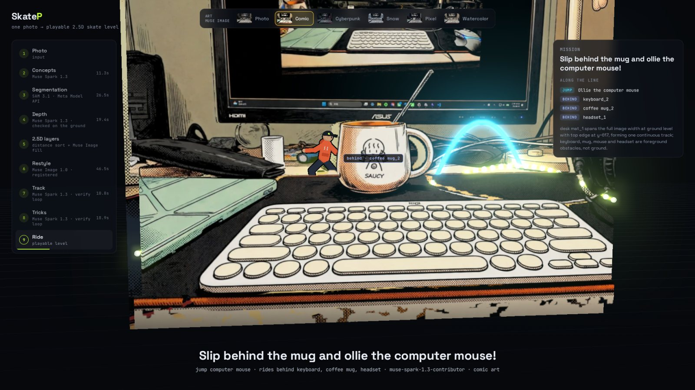
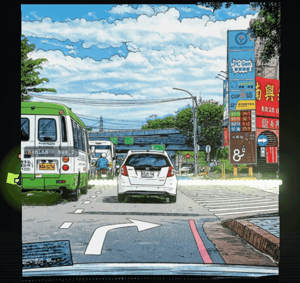
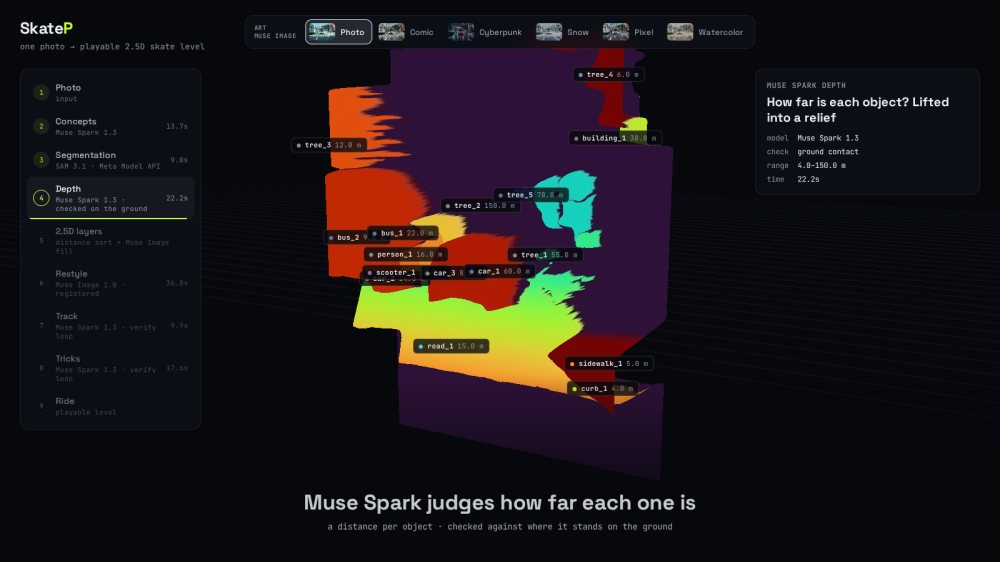

# Diorama

**A verified agentic pipeline: one photo in, a layered 2.5D scene you can move through.**

Diorama turns a single photo into a 2.5D scene: depth-ordered layers, each object's distance, the ground a character can stand on, and which real objects hide what. Meta's models do the reasoning, and every decision is checked against the image itself, so the scene holds together geometrically, not just visually.

Skateboarding is its first application: the scene becomes a playable level where the skater rides the real ground and slips behind the real objects in the shot, like AR on an ordinary screen.



<p align="center">
  
  <br><sub>One photo, played: the skater rides behind the real bus and car.</sub>
</p>

Built solo by **Ryder Wu** for the **Meta Global AI Developer Hackathon (2026)**, with SAM 3.1, Muse Spark and Muse Image through the Meta Model API.

## The 2.5D scene

| Output | What it holds |
|---|---|
| Layers | The photo cut into near, mid and far layers (RGBA), plus finer parallax planes for 3D views. The background behind the front layers is filled in. |
| Depth | Every object's distance from the camera, in meters. |
| Ground | The surface a character can stand on and the line along its top edge (`points`, 0..1 of the photo). |
| Occlusion | The objects in front of that line, and the stretches of it they cover. |
| Affordances | Places to jump over or grind along, each verified against the masks. |
| Art | The same scene in five art styles, cut with the same masks. |

The API returns the layers as PNGs and the ground line, occlusion and art style as JSON ([`wsl-cv/README.md`](wsl-cv/README.md#api)). Per-object distances, parallax planes and affordances are saved with each run and drive the 3D showcase.

## How the verified pipeline works

```
photo ─► perceive ─► decide ─► verify ─┬─► 2.5D scene
                       ▲               │
                       └─── repair ◄───┘  (violations, with the reason)
```

Muse Spark makes each decision, and a geometric check against SAM 3.1's masks accepts it or sends it back with the reason, up to three rounds:

1. **Perceive.** Muse Spark reads the photo and lists what to look for; SAM 3.1 segments each concept into object masks.
2. **Ground.** Muse Spark picks the surface to stand on. Check: it spans the scene at ground level.
3. **Depth.** Muse Spark estimates each object's distance. Check: on the ground plane, an object whose base is clearly lower in the photo must be nearer. The objects then split into depth layers, and the line along the ground's top edge is traced.
4. **Affordances.** Muse Spark proposes jumps and grinds. Check: a jump arc must clear the object's mask, a grind must follow its edge. Proposing none is allowed.
5. **Art.** Muse Image repaints the scene and fills what the foreground hides; each render is registered back onto the photo, so the masks still fit.

<table>
<tr>
<td width="33%"><br><sub>Muse Spark's distance for every object, in meters.</sub></td>
<td width="33%"><br><sub>The scene as depth-sorted planes.</sub></td>
<td width="33%"><br><sub>Affordances, verified against the SAM 3.1 masks.</sub></td>
</tr>
</table>

## Applications

**Built:** a skateboarding game. A Unity app on the phone sends a photo and plays the returned scene as a level: the skater rides the ground line and passes behind the occluders. A self-contained 3D page replays how each scene was built, including the jumps and grinds.

**What the scene could feed:** AR-style stickers and characters that go behind real objects, parallax animation of still photos, and levels for other 2D games such as platformers.

## Meta models used

| Model | Role |
|---|---|
| **Muse Spark 1.3** | Every decision in the pipeline: what to segment, the ground, each object's distance, the affordances and the level's mission, each inside a verify-and-repair loop. |
| **SAM 3.1** | Object masks from text concepts; the masks drive the layers, the line and every check. |
| **Muse Image 1.0** | Art styles and the background hidden behind foreground objects. |

All three are called through the Meta Model API; no other model runs, so the backend needs no GPU.

## Built during the hackathon

All code in this repository was written during the hackathon, with one exception: `unity_client/MobileCameraCapture.cs`, the photo capture and upload script of my existing Unity skateboarding game, which I extended during the event (map style picker, mission display, level metadata). The game itself is not in this repository.

| Built during the hackathon | |
|---|---|
| Perception | Muse Spark chooses what to segment per photo and SAM 3.1 segments it (`perception.py`, `sam31_segmentation.py`); Muse Spark estimates each object's distance, checked against the ground plane (`depth_order.py`) |
| Level design | Muse Spark surface choice, mission and occluders, each verified against the masks (`level_designer.py`); layers and track (`layers.py`, `track.py`) |
| Tricks | Muse Spark jumps and grinds with geometric verification (`feature_designer.py`) |
| Art | Muse Image styles and background fill, registered to the photo (`muse_image.py`) |
| Showcase | 3D replay of the whole pipeline, MP4 renderer, gallery and photo picker (`showcase*.py`, `preview_*`) |
| Serving | Level API and Windows gateway (`infer.py`, `win-server/`) |
| Unity | Map style picker, level data models, Editor smoke test (`ArtStyleSelector.cs`, `TrackModels.cs`, `Editor/`) |

## Getting started

### Requirements

- Linux or WSL2 with Python 3.10+; no GPU needed
- A [Meta Model API](https://dev.meta.ai/products/meta-model-api) key
- `ffmpeg` and Playwright, only for rendering showcase videos

### Installation

```bash
git clone https://github.com/ryder1018/skateboard-META.git
cd skateboard-META

conda create -n diorama python=3.10 -y
conda activate diorama

pip install -r wsl-cv/requirements.txt

# Optional: the browser that renders showcase MP4s
python -m playwright install chromium
```

Put your API key in a `.env` file at the repository root (it is git-ignored):

```bash
echo "MODEL_API_KEY=<your Meta Model API key>" > .env
```

### Try it on a photo

```bash
cd wsl-cv
./try_photo.sh assets/pictures/cup.jpg
```

This runs the full pipeline (2–4 minutes) and writes `showcase/cup/`: the Unity layers and `track_points.json`, plus `showcase.html`, a self-contained 3D replay of every step that ends with the skater riding the level. Press **F** in the ride to toggle whether foreground objects fade or fully hide the skater.

### Batch mode and the photo picker

Drop photos into `wsl-cv/photos/`, then:

```bash
./run_photos.sh --preview      # track, depth + layers only, ~1.5 min per photo; opens showcase/preview.html
./run_photos.sh cup street2d   # build the photos you picked (reuses their previewed track)
./run_photos.sh                # or build every photo that has no showcase yet
```

`showcase/index.html` links every built level. More options (`--restyle`, `--tricks`, `--video`) are in [`wsl-cv/README.md`](wsl-cv/README.md).

### Play it in Unity

The phone game talks to the backend through a small Windows gateway:

```
Unity app ──► win-server (Windows, :5000) ──► wsl-cv FastAPI (WSL, :9000)
```

```bash
cd wsl-cv && uvicorn scripts.infer:app --host 0.0.0.0 --port 9000   # in WSL, with MODEL_API_KEY set
```

Then start `win-server/server.py` on Windows and point the app at it. The step-by-step guide, including the upload test and the Unity Editor smoke test, is in [`setup.md`](setup.md).

## Repository layout

```
wsl-cv/            CV backend (Python): pipeline, FastAPI server, showcase
  scripts/         pipeline steps, Meta Model API clients, showcase builder
  showcase/        generated sample levels (open index.html)
  assets/pictures/ sample photos
win-server/        Windows gateway between the phone and WSL (Flask)
unity_client/      Unity scripts for capture, upload, style picker and smoke test
docs/              architecture notes and README images
setup.md           running the full phone → gateway → backend loop
```

The Unity game project itself is not in this repository; `unity_client/` holds the scripts that connect it to the backend. See [`docs/ARCHITECTURE.md`](docs/ARCHITECTURE.md) for the data flow and the JSON contract.

## Credits

- [three.js](https://threejs.org/) (MIT) for the 3D showcase, loaded from a CDN.
