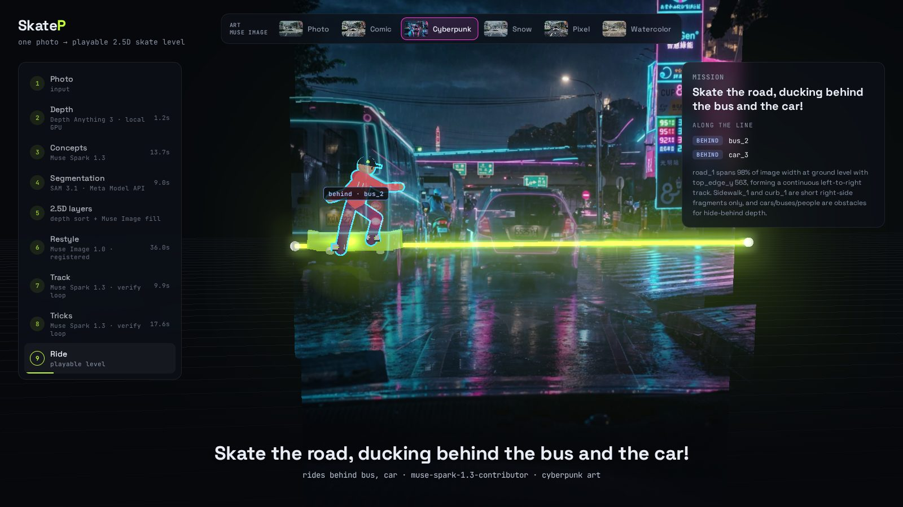
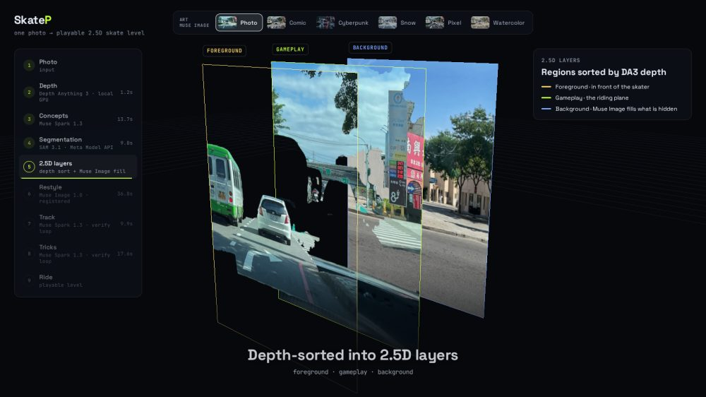
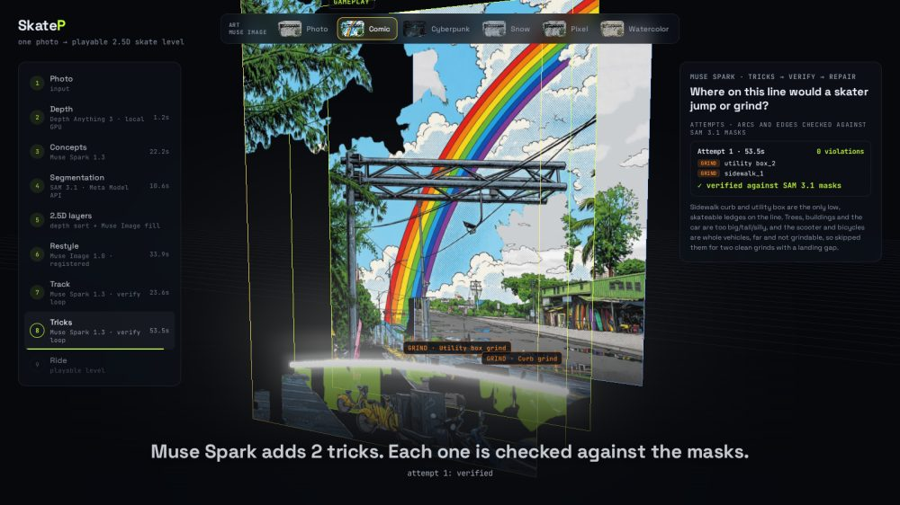

# SkateP

**Turn any photo into a playable 2.5D skate level.**

SkateP is an exploration of 2.5D: how much of the real world's depth can a single phone photo carry? It splits the photo into depth-ordered layers, so a flat picture becomes a small stage with a foreground, a ground to ride on and a background, and the character moves *between* them, passing behind the real chair or car in your shot. The goal is the sense of space you get from VR or AR, on an ordinary flat screen, with no headset, depth sensor or 3D scan: just one photo.

To make that space playable, SkateP finds what you can ride on, draws a line across it, places jumps and grinds, and repaints the level in an art style of your choice. The level loads straight into a Unity skateboarding game on your phone.



Built solo by **Ryder Wu** for the **Meta Global AI Developer Hackathon (2026)**, with SAM 3.1, Muse Spark and Muse Image through the Meta Model API.

## How it works

```
photo ─► Depth Anything 3 ─► Muse Spark ─► SAM 3.1 ─► 2.5D layers ─► Muse Spark ─► Muse Spark ─► Muse Image ─► level
         depth map           what's in     object      near / mid /    riding line,   jumps and    art style +
                             this scene?   masks       far by depth    mission        grinds       background fill
```

1. **Read the scene.** Muse Spark looks at the photo and lists the objects worth finding: what could be skated (stairs, curbs, desk mats) and what is just scenery.
2. **Segment.** SAM 3.1 turns each concept into pixel masks. Depth Anything 3 sorts them into foreground, gameplay and background layers.
3. **Design the line.** Muse Spark picks the riding surface and writes the level's mission. Every proposal is checked against the masks (does the surface span the scene at ground level?) and violations are sent back for repair.
4. **Add tricks.** Muse Spark proposes jumps over objects that stand on the line and grinds along edges that follow it. Each is verified geometrically (the jump arc must clear the mask, the grind must follow the edge) or dropped. Zero tricks is an allowed answer.
5. **Restyle.** Muse Image repaints the photo as comic, cyberpunk, snow, pixel art or watercolor, and fills in what the foreground hides. Each render is registered back onto the photo and re-cut with the original masks, so the track and occluders still line up.

<table>
<tr>
<td width="50%"><br><sub>Depth-sorted 2.5D layers: the skater rides between them.</sub></td>
<td width="50%"><br><sub>Muse Spark's trick proposals, verified against the SAM 3.1 masks.</sub></td>
</tr>
</table>

## Meta models used

| Model | Role in SkateP |
|---|---|
| **SAM 3.1** | Segments the photo from text concepts into object masks; the masks drive the layers, the track and every geometric check. |
| **Muse Spark 1.3** | Chooses what to segment, picks the riding surface, writes the mission, and designs jumps and grinds, each inside a verify-and-repair loop against the masks. |
| **Muse Image 1.0** | Restyles the level into five art styles and fills the background hidden behind foreground objects. |

All three are called through the Meta Model API. Depth comes from [Depth Anything 3](https://github.com/ByteDance-Seed/Depth-Anything-3) (`da3-small`), run locally.

## Built during the hackathon

SkateP started from an existing prototype: a Unity skate game plus a backend that cut a photo into layers with DA3 depth and SAM 2. That baseline is commit [`e5c732f`](https://github.com/ryder1018/skateboard-META/commit/e5c732f). Everything after it was built during the hackathon:

| Area | New in the hackathon | Existing before |
|---|---|---|
| Segmentation | SAM 3.1 via the Meta Model API, with Muse Spark choosing the concepts per photo | SAM 2 automatic masks (no labels) |
| Level design | Muse Spark surface choice, mission and occluders (`level_designer.py`), all verified against the masks | Geometric track pick |
| Tricks | Muse Spark jumps and grinds with geometric verification (`feature_designer.py`) | — |
| Art | Muse Image styles and background fill, registered to the photo (`muse_image.py`) | OpenCV inpainting |
| Showcase | 3D replay of the whole pipeline, MP4 renderer, gallery and photo picker (`showcase*.py`, `preview_*`) | — |
| Unity | Map style picker, mission display, level metadata, Editor smoke test (`ArtStyleSelector.cs`, `TrackModels.cs`, `Editor/`) | Capture/upload client, the game itself |
| Depth, track extraction, gateway | Small fixes only | Depth Anything 3 adapter, `extract_track.py`, `win-server/` |

## Getting started

### Requirements

- Linux or WSL2, Python 3.10, an NVIDIA GPU with CUDA (for Depth Anything 3)
- A [Meta Model API](https://dev.meta.ai/products/meta-model-api) key
- `ffmpeg` and Playwright, only for rendering showcase videos

### Installation

```bash
git clone https://github.com/ryder1018/skateboard-META.git
cd skateboard-META

conda create -n skatep python=3.10 -y
conda activate skatep

# Depth Anything 3 (installed as a package, not vendored here)
git clone https://github.com/ByteDance-Seed/Depth-Anything-3 ../Depth-Anything-3
pip install -e ../Depth-Anything-3

pip install -r wsl-cv/requirements.txt

# Optional: showcase MP4 rendering
pip install playwright && python -m playwright install chromium
```

Put your API key in a `.env` file at the repository root (it is git-ignored):

```bash
echo "MODEL_API_KEY=<your Meta Model API key>" > .env
```

### Generate a level from a photo

```bash
cd wsl-cv
./try_photo.sh assets/pictures/cup.jpg
```

This runs the full pipeline (2–4 minutes) and writes `showcase/cup/`: the Unity layers and `track_points.json`, plus `showcase.html`, a self-contained 3D replay of every step that ends with the skater riding the level. Press **F** in the ride to toggle whether foreground objects fade or fully hide the skater.

### Batch mode and the photo picker

Drop photos into `wsl-cv/photos/`, then:

```bash
./run_photos.sh --preview      # track + layers only, ~1 min per photo; opens showcase/preview.html
./run_photos.sh cup street2d   # build the photos you picked (reuses their previewed track)
./run_photos.sh                # or build every photo that has no showcase yet
```

`showcase/index.html` links every built level. More options (`--restyle`, `--tricks`, `--video`) are in [`wsl-cv/README.md`](wsl-cv/README.md).

### Play it in Unity

The phone game talks to the backend through a small Windows gateway:

```
Unity app ──► win-server (Windows, :5000) ──► wsl-cv FastAPI (WSL, :9000)
```

```bash
cd wsl-cv && uvicorn scripts.infer:app --host 0.0.0.0 --port 9000   # in WSL, with MODEL_API_KEY set
```

Then start `win-server/server.py` on Windows and point the app at it. The step-by-step guide, including the upload test and the Unity Editor smoke test, is in [`setup.md`](setup.md).

## Repository layout

```
wsl-cv/            CV backend (Python): pipeline, FastAPI server, showcase
  scripts/         pipeline steps, Meta Model API clients, showcase builder
  showcase/        generated sample levels (open index.html)
  assets/pictures/ sample photos
win-server/        Windows gateway between the phone and WSL (Flask)
unity_client/      Unity scripts for capture, upload, style picker and smoke test
docs/              architecture notes and README images
setup.md           running the full phone → gateway → backend loop
```

The Unity game project itself is not in this repository; `unity_client/` holds the scripts that connect it to the backend. See [`docs/ARCHITECTURE.md`](docs/ARCHITECTURE.md) for the data flow and the JSON contract.

## Credits

- [Depth Anything 3](https://github.com/ByteDance-Seed/Depth-Anything-3) by ByteDance Seed, for monocular depth (see its repository for the code and model licenses).
- [three.js](https://threejs.org/) (MIT) for the 3D showcase, loaded from a CDN.
