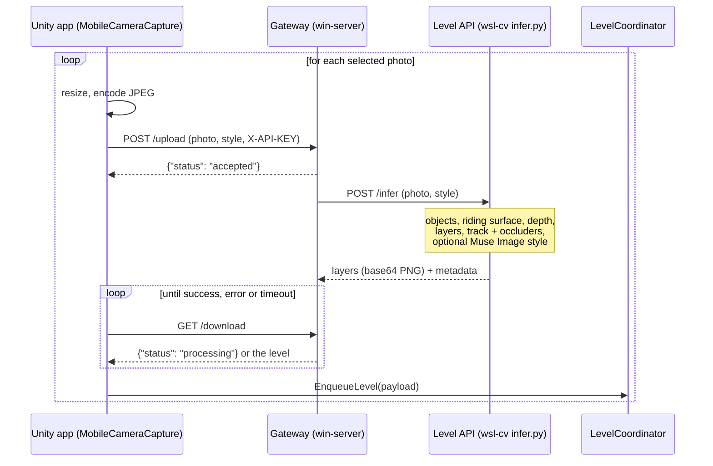

# Architecture

SkateP has three parts that run on different machines. A photo crosses all three boundaries, so read this before changing anything that one side sends to another. Setup steps are in [`setup.md`](../setup.md).

| Part | Runs on | Role |
|---|---|---|
| `unity_client/` | phone (Unity, C#) | capture or pick photos, upload, poll, load the returned level into the game |
| `win-server/` | Windows PC (Flask) | the address the phone can reach; forwards each photo to WSL and holds the result until the phone collects it |
| `wsl-cv/` | WSL / Linux (FastAPI) | the 2.5D scene agent: SAM 3.1 objects, Muse Spark ground, depth and level design, Muse Image art |

`unity_client/` holds only the scripts that connect the existing Unity skate game to this backend, not the game project itself.

## One photo, end to end

- **One level at a time.** The gateway keeps a single job; the app uploads the selected photos one after another and polls for each, so jobs never overlap.
- **Timing.** A level takes about 75–105 s (longer when Muse Spark needs repairs or Muse Image retries), so the app polls by elapsed time (`processingTimeoutSeconds`, default 320 s), not by attempt count.
- **Art style.** The app's map style picker (`ArtStyleSelector.cs`) sends `style`; the gateway forwards it; the API returns the Muse Image layers, cut with the same masks, plus `metadata.art_style` and a matching `metadata.track_color`. `original` keeps the photo's pixels. The response shape never changes.
- **Drawing order.** Unity draws background (far layer), gameplay (mid), the track and skater, then foreground (near). `metadata.occluded_segments` lists the track stretches the foreground covers, by point index; `metadata.level.occluders` names those objects.
- **On the device.** Each level's metadata is also saved to `Application.persistentDataPath/schema_XX.json` (and `schema.json`). `LocalLevelTester` loads its baked levels only in the Editor unless `applyOnStartInBuilds` is set.

## Contracts

- **App → gateway:** `POST /upload` multipart `photo` (+ `style`), header `X-API-KEY` (`SKATEP_API_KEY`, default `0000`); `GET /download` with the same header.
- **Gateway → app:** `{"status": "processing" | "success" | "error", "images": {...}, "metadata": {...}, "message": "..."}`, deserialized by `ServerResponse` in `MobileCameraCapture.cs` and `TrackData` in `TrackModels.cs`.
- **API → gateway:** the `/infer` response documented in [`wsl-cv/README.md`](../wsl-cv/README.md#api). The track is `metadata.points`, `[x, y]` pairs in 0..1 of the photo, left to right.

Field names in these payloads are read by C# classes; renaming one breaks the app silently (the field just stays empty), so change both sides together.
